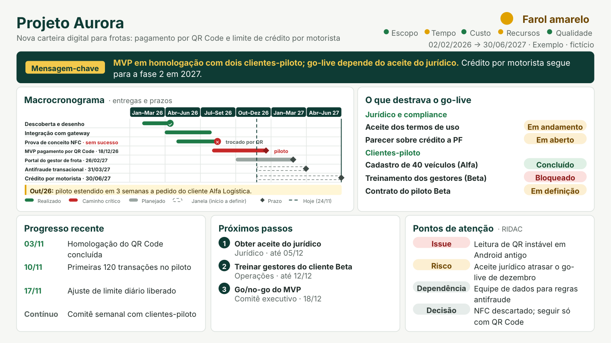

# Status Report Generator

Gera um **status report one-page em PowerPoint** a partir de uma planilha Excel com formato
pré-definido. Funciona como app web (Streamlit) ou pela linha de comando.

**Demonstração online:** [report.jpfranca.com](https://report.jpfranca.com). Baixe o modelo, preencha e gere
o slide sem instalar nada. Não envie dados confidenciais para a demonstração.



*Slide gerado a partir de `modelo_status_report.xlsx` (Projeto Aurora, dados fictícios).*

## O que o slide traz

- Cabeçalho com nome, descrição, período do projeto e farol (geral + escopo, tempo, custo, recursos, qualidade)
- Mensagem-chave em destaque
- **Macrocronograma** com escala de trimestres automática, linha de "hoje", prazos e nota opcional
- Bloco "O que destrava o projeto" com itens agrupados e status
- Progresso recente, próximos passos e pontos de atenção (RIDAC)

Tudo sai como **formas nativas do PowerPoint**: dá para ajustar à mão depois de gerado.

## Requisitos

- Python **3.11 a 3.14**. Versões recém-lançadas (ex.: 3.15) podem ainda não ter pacotes prontos
  das dependências e falhar no `pip install`.
- Opcional: **LibreOffice**, só para ver a prévia do slide dentro do app. Sem ele, o .pptx é gerado normalmente.

## Instalação no Windows

1. Instale o Python 3.13 em [python.org/downloads](https://www.python.org/downloads/). Na instalação,
   marque **"Add python.exe to PATH"**.
2. Baixe o repositório (botão **Code › Download ZIP**, ou `git clone`).
3. Dê duplo clique em **`iniciar.bat`**.
   Na primeira vez ele cria um ambiente isolado (`.venv`) e instala as dependências; depois só abre o app.
4. O navegador abre em `http://localhost:8501`.

Se preferir o terminal (PowerShell ou cmd):

```bat
git clone https://github.com/jpfranca-br/status_report_generator.git
cd status_report_generator
py -3.13 -m venv .venv
.venv\Scripts\python -m pip install -r requirements.txt
.venv\Scripts\python -m streamlit run app.py
```

> Use sempre `python -m pip` / `python -m streamlit` (ou o `py -3.13`) para garantir que o pip e o
> Streamlit sejam do mesmo Python. `python app.py` **não** funciona: o app precisa ser iniciado pelo Streamlit.

## Instalação no Linux (Debian/Ubuntu)

O `install.sh` instala tudo e deixa o app rodando como serviço systemd (sobe sozinho com o servidor):
Python e dependências num `.venv`, LibreOffice para a prévia e as fontes. Rode como seu usuário
normal, não como root; o script pede `sudo` quando precisa e o serviço roda com o seu usuário.

```bash
sudo apt update && sudo apt install -y git
git clone https://github.com/jpfranca-br/status_report_generator.git
cd status_report_generator
./install.sh
```

Por padrão o app escuta só em `127.0.0.1:8501`. Para outra porta: `PORTA=8600 ./install.sh`.

Para **atualizar**, rode `git pull` e depois `./install.sh` de novo. Logs: `journalctl -u status-report -f`.

O serviço vem com limites de memória/CPU e isolamento: só escreve na pasta do app e num `/tmp` privado.
O modelo dele está em `deploy/status-report.service`.

### Acesso a partir de outra máquina

O app **não tem login**. Não o exponha direto na internet.

- **Uso pessoal: túnel SSH.** No seu computador:
  `ssh -L 8501:localhost:8501 usuario@servidor` e abra `http://localhost:8501`.
- **Uso pelo time:** coloque um proxy reverso com HTTPS e autenticação na frente. Exemplo com Caddy:

  ```
  status.seudominio.com {
      basic_auth {
          # gere o hash com: caddy hash-password
          equipe $2a$14$...
      }
      reverse_proxy 127.0.0.1:8501
  }
  ```

### Expor na internet

O app já se protege de uso abusivo: aceita até 5 planilhas de 2 MB por envio
(`.streamlit/config.toml`), recusa arquivos que crescem demais ao descompactar, lê no máximo 500 linhas
por aba e gera uma prévia do LibreOffice por vez. Mesmo assim, deixe o app escutando só em `127.0.0.1` e
publique por um túnel ou proxy (ex.: Cloudflare Tunnel), com rate limiting e desafio anti-bot na frente.

## Uso

### App web

1. Clique em **Baixar modelo** na barra lateral para pegar a planilha de exemplo.
2. Preencha com os dados do seu projeto.
3. Suba a planilha. Mais de uma planilha = um slide por projeto no mesmo arquivo.
4. Confira os avisos e a prévia e clique em **Baixar PowerPoint**.

### Linha de comando

```bash
python gerador.py projeto.xlsx                          # gera projeto.pptx
python gerador.py projeto_a.xlsx projeto_b.xlsx -o semana.pptx
```

## Formato da planilha

A planilha modelo tem uma aba **Instruções**. Resumo:

| Aba | Colunas |
|---|---|
| `Projeto` | `campo` / `valor`: nome, descricao, inicio, fim, classificacao, data_referencia, farol, farol_escopo, farol_tempo, farol_custo, farol_recursos, farol_qualidade, mensagem_destaque, mensagem_complemento, subtitulo_cronograma, nota_cronograma, titulo_destravadores |
| `Cronograma` | `titulo`, `inicio`, `fim`, `prazo`, `status`, `observacao` |
| `Destravadores` | `grupo`, `item`, `status` |
| `Progresso` | `data`, `texto` |
| `Proximos passos` | `acao`, `detalhe` |
| `RIDAC` | `tipo`, `descricao` |

**Status do cronograma**

| status | desenho |
|---|---|
| `concluido` | barra verde com ✓ no fim |
| `realizado` | barra verde |
| `sem_sucesso` | barra verde com ✕ vermelho e "sem sucesso" no rótulo |
| `critico` | barra vermelha (caminho crítico) |
| `planejado` | barra cinza |
| `janela` | barra tracejada de "hoje" (ou do início, se houver) até o fim: início a definir |

- `prazo` desenha um losango na data; `observacao` aparece ao lado da barra.
- `data_referencia` vazio = a linha "Hoje" usa a data de geração.
- `nota_cronograma` vai para o maior espaço livre do gráfico, ou para uma faixa abaixo das barras.
- Status em `Destravadores`: "Bloqueado" fica vermelho, "Concluído" verde, os demais amarelo.

Se algum texto não couber, o gerador **avisa** em vez de gerar um slide quebrado.

## Personalização

Fonte e cores ficam no topo de `gerador.py` (`FONTE` e `COR`). A fonte padrão é Segoe UI (Windows).
Para mudar o conteúdo de exemplo do botão **Baixar modelo**, edite `criar_modelo.py`.

> **Dados reais:** o `.gitignore` ignora todos os `.xlsx` e `.pptx`, exceto a planilha modelo, para
> evitar que planilhas de projetos reais sejam versionadas por engano.

## Licença

[MIT](LICENSE)
